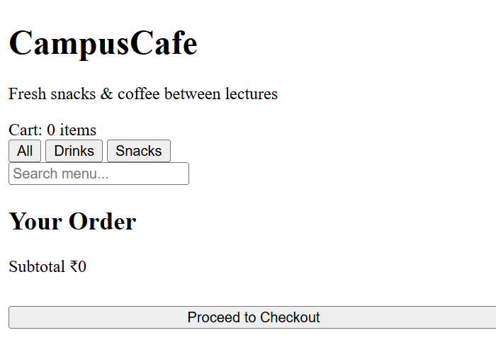
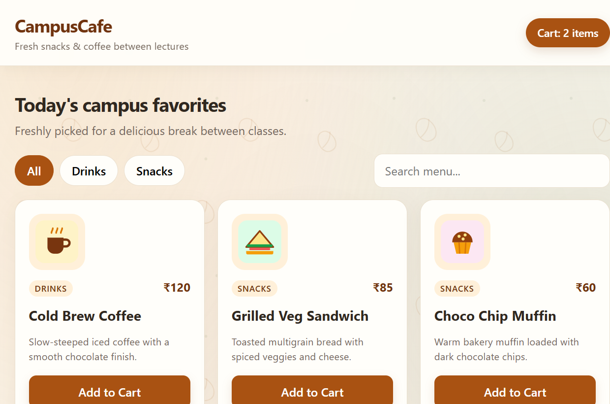

# CampusCafe Debugging and Enhancement Report

**Project:** CampusCafe student ordering website  
**Technology:** HTML, CSS, vanilla JavaScript  
**Pages:** Menu and checkout  
**Submission:** Before-and-after code examples and browser screenshots

## 1. Project overview

CampusCafe is a small, responsive website for browsing campus café drinks and snacks, building an order, and reviewing it at checkout. The original starter project contained incorrect resource paths, incomplete cart and checkout logic, and unfinished filtering and search.

## 2. Problems found

- CSS and script URLs did not match the project folders; checkout used incorrect relative URLs.
- The menu data script was included after the application script, so `MENU_ITEMS` was unavailable during initialization.
- Product image paths and icon filenames did not match the files on disk.
- Only the first add button received a click handler, and repeated additions created duplicate rows.
- Cart values could remain strings; totals ignored quantities and the badge counted rows instead of items.
- Menu and checkout used different local-storage keys. The checkout also selected a non-existent grand-total ID.
- Filtering, search, quantity controls, promo validation, and order confirmation were unfinished.

## 3. Files changed

| File | Changes |
| --- | --- |
| `index.html` | Corrected CSS and script URLs and script order; added accessible filter/search markup and cart feedback. |
| `pages/checkout.html` | Corrected relative CSS, script, and back-navigation paths; added required student fields and accessible status messages. |
| `scripts/menuData.js` | Changed prices to numbers and fixed product SVG paths. |
| `scripts/app.js` | Implemented menu rendering, category/search filtering, cart quantity controls, numeric totals, persistence, and empty-cart protection. |
| `scripts/checkout.js` | Implemented shared cart loading, GST/discount/grand-total calculations, promo validation, form checks, Order ID, and cart clearing. |
| `styles/main.css` | Improved card/cart styles, responsive layouts, focus states, and reduced-motion behavior. |
| `styles/theme.css`, `assets/bg-pattern.svg` | Added the café color palette, local background asset, and subtle original coffee-bean pattern. |
| `README.md` | Added project overview, run instructions, features, screenshots, testing, and limitations. |

## 4. Before-and-after code examples

### A. Load menu data before the application

**Before — `index.html`:**

```html
<script src="scripts/app.js"></script>
<script src="js/menuData.js"></script>
```

**After — `index.html`:**

```html
<script src="scripts/menuData.js"></script>
<script src="scripts/app.js"></script>
```

The corrected order defines `MENU_ITEMS` before `app.js` initializes the menu.

### B. Wire every add button and increment an existing item

**Before — `scripts/app.js`:** the code selected only the first matching button and always pushed a new row.

```js
const addButton = document.querySelector(".add-btn");
if (addButton) {
  addButton.addEventListener("click", () => addToCart(Number(addButton.dataset.id)));
}

cart.push({ id: found.id, name: found.name, price: found.price, qty: 1 });
```

**After — `scripts/app.js`:** each card gets its own listener; repeated additions increment the matching item.

```js
addButton.addEventListener("click", () => addToCart(item.id));

const existingItem = cart.find((item) => item.id === itemId);
if (existingItem) {
  existingItem.qty += 1;
} else {
  cart.push({
    id: found.id,
    name: found.name,
    price: Number(found.price),
    qty: 1
  });
}
```

### C. Calculate subtotal and item count using quantities

**Before — `scripts/app.js`:**

```js
let subtotal = 0;
cart.forEach((item) => {
  subtotal = subtotal + item.price;
});
cartCountEl.textContent = cart.length;
```

**After — `scripts/app.js`:**

```js
const subtotal = cart.reduce(
  (sum, item) => sum + item.price * item.qty,
  0
);
const itemCount = cart.reduce((sum, item) => sum + item.qty, 0);

cartSubtotalEl.textContent = subtotal.toFixed(2);
cartCountEl.textContent = itemCount;
```

### D. Use one storage key and the matching grand-total element

**Before — checkout mismatch:**

```js
const cart = JSON.parse(localStorage.getItem("cartItems")) || [];
const grandTotalEl = document.getElementById("total-amount");
```

**After — `scripts/checkout.js` and `pages/checkout.html`:**

```js
const cartStorageKey = "campus_cart";
const cart = JSON.parse(localStorage.getItem(cartStorageKey) || "[]");
const grandTotalEl = document.getElementById("grand-total");
```

The menu and checkout now read the same cart key, and the script updates the actual element ID in the HTML.

### E. Validate the student promotion

**Before — `scripts/checkout.js`:**

```js
promoMsgEl.textContent = "Promo logic not implemented yet.";
```

**After — `scripts/checkout.js`:**

```js
if (promoCode !== "STUDENT15") {
  promoMsgEl.textContent = "That promo code is invalid. Please try STUDENT15.";
} else if (subtotal < 150) {
  promoMsgEl.textContent = "STUDENT15 requires a subtotal of at least ₹150.";
} else {
  discountAmount = subtotal * 0.15;
  promoMsgEl.textContent = "STUDENT15 applied: 15% off your subtotal.";
}
```

Invalid and under-minimum codes leave the discount at zero. A valid code discounts 15% of the subtotal when the subtotal is at least ₹150.

### F. Block empty checkout and validate an order

**Before — `scripts/app.js` / `scripts/checkout.js`:** the starter always navigated to checkout, and order confirmation was unfinished.

```js
checkoutBtn.addEventListener("click", () => {
  window.location.href = "pages/checkout.html";
});

orderMsgEl.textContent = "Order confirmation logic not implemented yet.";
```

**After — `scripts/app.js` / `scripts/checkout.js`:**

```js
if (cart.length === 0) {
  cartMsgEl.textContent = "Add at least one item before checkout.";
  return;
}

if (!studentNameInput.value.trim() || !rollNumberInput.value.trim()) {
  orderMsgEl.textContent = "Please enter your full name and roll number.";
  return;
}

const orderId = `CC-${Date.now().toString(36).toUpperCase()}-${Math.random().toString(36).slice(2, 7).toUpperCase()}`;
localStorage.removeItem(cartStorageKey);
```

The handler then clears the in-memory cart, refreshes the checkout summary, and displays a success message with the generated Order ID.

## 5. Before-and-after screenshots

The “before” image is a **reproduction** of the starter page with its original broken paths and script order; it is not a historical screenshot from before editing. The “after” image shows the repaired menu and product icons.

### Before: broken resources and empty menu



### After: styled menu with working product cards



## 6. Other completed behavior

- Category buttons and live search work together.
- Plus/minus controls update quantities; reducing an item to zero removes it.
- The cart badge shows total units, subtotal uses item prices and quantities, and an empty cart cannot proceed to checkout.
- Checkout shows saved cart contents, subtotal, 5% GST, discount, and grand total.
- Full name and roll number are required. Empty carts cannot be confirmed.
- A valid submission displays an Order ID and clears the saved cart.
- The design adapts to desktop, tablet, and mobile screens and includes keyboard focus and screen-reader status support.

## 7. Testing performed

- Checked JavaScript syntax with `node --check` for `app.js`, `checkout.js`, and `menuData.js`.
- Browser-tested all menu buttons, search, product icons, cart quantity changes, totals, and checkout navigation.
- Tested cart persistence, invalid promo codes, the ₹150 threshold, and the valid discount calculation.
- Tested required student details, empty-cart rejection, successful order confirmation, and cart clearing.
- Checked desktop, tablet, and mobile layouts for horizontal overflow.

## 8. Scope and limitations

This is a front-end demonstration. Cart contents use browser `localStorage`; orders are not sent to a server, and Order IDs are not saved to a database. There is no payment processing or live inventory system.

## 9. Reflection

A single pasted file does not reveal the rest of a project's structure, its asset locations, or how different pages share data. Inspecting the complete workspace makes it possible to trace related HTML, CSS, JavaScript, and asset paths together and verify that the corrections work across the application.
