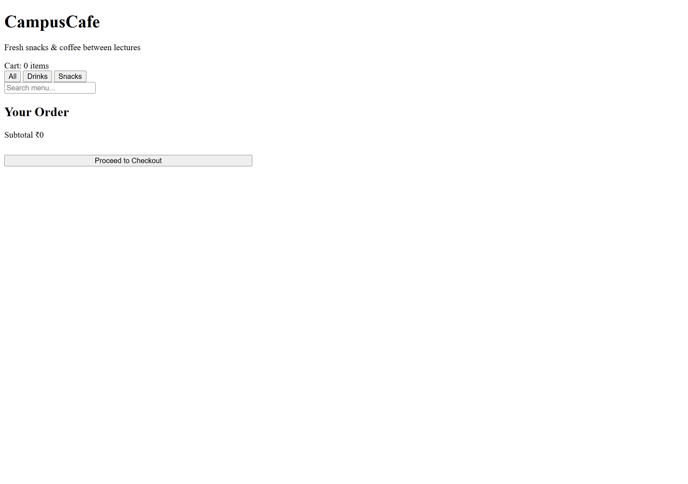
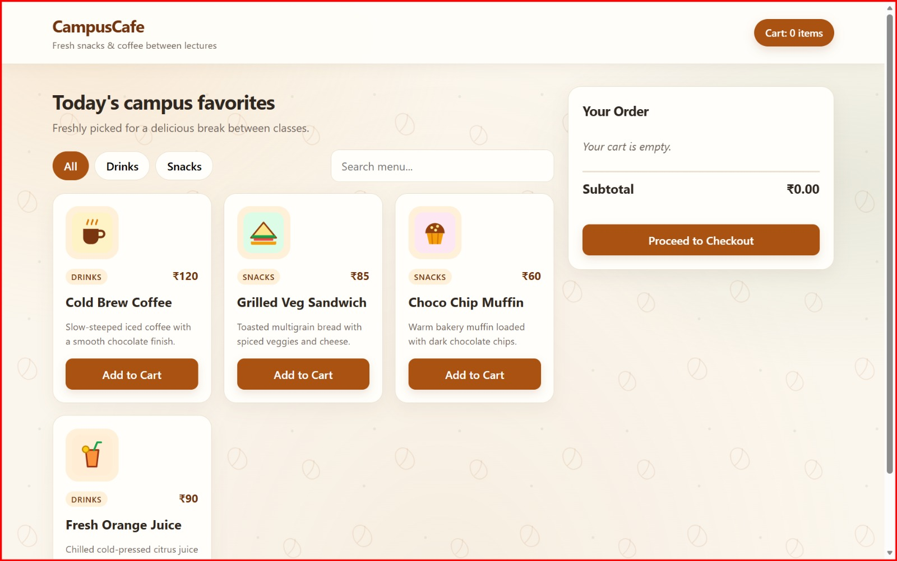

# CampusCafe

A responsive, two-page campus café ordering demo built with HTML, CSS, and vanilla JavaScript. Browse the menu, search and filter items, manage a cart, and complete a sample student checkout.

## Features

- Browse café drinks and snacks with product icons, descriptions, and prices.
- Filter by category and search menu items by name.
- Add products to the cart, adjust quantities, and see the item count and subtotal update.
- Keep cart contents between the menu and checkout pages using browser local storage.
- Apply `STUDENT15` for 15% off the subtotal when it is at least ₹150.
- Review 5% GST, discount, and grand total before confirming an order.
- Validate student details and display a generated Order ID on confirmation.
- Responsive layout, keyboard focus styles, and screen-reader labels/status messages.

## Run locally

No package installation or build step is required.

1. Download or clone this repository.
2. Open `index.html` in a modern web browser.
3. Add menu items and select **Proceed to Checkout** to try the checkout flow.

The app uses browser `localStorage` to keep the cart. If testing in a browser that restricts storage on local files, serve the project with a local static web server instead.

## Project structure

```text
CampusCafe/
├── assets/
│   ├── bg-pattern.svg
│   └── icons/
├── pages/
│   └── checkout.html
├── scripts/
│   ├── app.js
│   ├── checkout.js
│   └── menuData.js
├── screenshots/
│   ├── after.png
│   └── before.png
├── styles/
│   ├── main.css
│   └── theme.css
├── CampusCafe_Debugging_Report.docx
└── index.html
```

## Screenshots

The “before” image reproduces the original broken resource paths and script-loading order; it is not a historical screenshot.

| Before debugging | After debugging |
| --- | --- |
|  |  |

## Report

The submission report includes the issues found, corrections made, validation performed, project limitations, and before-and-after screenshots: [CampusCafe_Debugging_Report.docx](CampusCafe_Debugging_Report.docx).

## Testing

The menu and checkout flows were tested in a browser, including:

- Category filters, live search, and product image loading.
- Adding items, changing quantities, removing cart rows, and calculating the subtotal.
- Cart persistence between pages and blocking checkout for an empty cart.
- Valid and invalid promo codes, including the ₹150 minimum.
- GST and grand-total calculations, student form validation, order confirmation, and cart clearing.
- Desktop, tablet, and mobile layouts.

JavaScript syntax can be checked with:

```powershell
node --check scripts\app.js
node --check scripts\checkout.js
node --check scripts\menuData.js
```

## Limitations

This is a front-end demonstration, not a production ordering system. Orders are not sent to a server, and the generated Order ID is not stored in a database. There is no payment processing or real inventory management.
